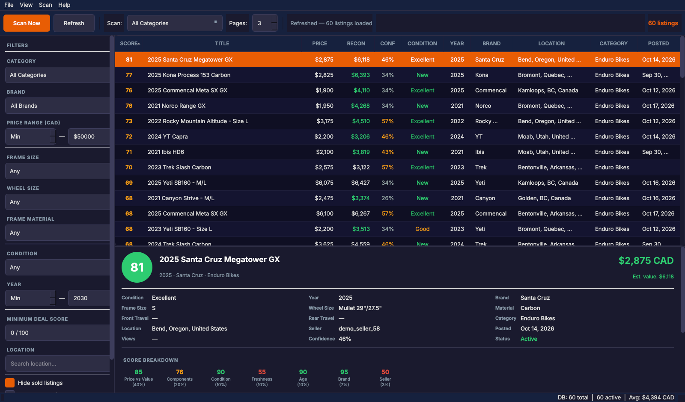

# PinkbikeDeals

A desktop app that scrapes the Pinkbike BuySell marketplace, estimates what each
bike is actually worth by reconstructing its build from the listing text, and
surfaces the listings priced well below that estimate.

Python 3.10+ · PyQt6 · SQLAlchemy/SQLite · httpx



*Demo data: the listings in this screenshot are made up.*

## The problem

Used bike listings are hard to compare. Two bikes with the same frame and the
same asking price can differ by thousands of dollars in real value depending on
the drivetrain, fork, wheels and brakes hanging off them, and that information
is buried in free-text listing descriptions. Sorting by price doesn't find
deals; it finds cheap bikes.

## The approach

Rather than comparing a listing to "similar" listings, PinkbikeDeals values each
bike from the bottom up:

1. **Component extraction** — parse the listing title and description to identify
   what's actually on the bike across 12 component slots (fork, shock,
   drivetrain, brakes, wheels, dropper, and so on). Component names in listings
   are inconsistent and abbreviated, so matching is fuzzy (`thefuzz`) against a
   curated component-value database.
   Sellers rarely write full names ("Float X2 Factory", "Reserve 30 wheels"), so
   each part also matches on its common short forms, on word boundaries.
2. **Build valuation** — convert each identified component to a used value, apply
   a frame value derived from brand tier and material, and deduct for stated
   issues. On a complete bike, any major part the seller didn't mention (fork,
   shock, drivetrain, brakes, wheels) is filled in at the typical value for the
   build's tier rather than counted as $0. The result is a reconstructed total
   value plus a **confidence** figure reflecting how much of the build was
   actually identified.
3. **Deal scoring** — combine seven weighted components into a 0–100 score:

   | Component | Weight | What it measures |
   |---|---|---|
   | Price vs. reconstructed value | 40% | The core signal |
   | Component quality | 20% | How good the build actually is |
   | Condition vs. price | 10% | Stated condition relative to ask |
   | Model year | 10% | Age of the platform |
   | Listing freshness | 10% | How recently posted |
   | Frame brand tier | 7% | Resale desirability |
   | Seller signals | 3% | Trust heuristics |

Low build confidence doesn't produce a garbage score — the price-vs-value
component blends toward neutral in proportion to confidence, so a listing with
almost no component detail still gets ranked on frame value, brand and age
rather than on noise. Listings in bike categories that clearly aren't bikes
(decals, "WTB" posts, anything under $150) are capped at a score of 10.

## Scraping

Pinkbike serves BuySell behind Cloudflare, which blocks plain HTTP clients. The
scraper uses [cloudscraper](https://github.com/VeNoMouS/cloudscraper), which presents
as a desktop Chrome browser and passes Cloudflare's JavaScript check. It keeps its
load light: 3 concurrent requests at most, 1–2 second jittered delays, exponential
backoff on errors, a daily request cap, short "hot scans" every 15 minutes for new
listings and one deep refresh overnight. It only reads public listing pages; it never
logs in or posts anything.

This is a personal, educational project. Pinkbike's terms of use apply to anyone who
runs it, so read them first. The valuation and scoring code (`src/scoring/`) doesn't
depend on Pinkbike at all and works on any listing title and description.

## Architecture

```
src/
├── scraper/      fetching, parsing, scheduling
│   ├── client.py         rate-limited HTTP client
│   ├── parser.py         listing HTML → structured data
│   └── scheduler.py      hot scans + nightly deep refresh
├── scoring/      the valuation model
│   ├── component_extractor.py   listing text → identified build
│   ├── component_values.py      component price/tier database
│   ├── build_valuator.py        build → reconstructed value
│   └── deal_scorer.py           the 7-component score
├── database/     SQLAlchemy models, queries, price history
├── gui/          PyQt6 interface (table, filters, detail panel)
└── main.py
```

## Running it

```bash
pip install -r requirements.txt
python run.py            # GUI
python src/main.py       # CLI
```

Tests:

```bash
pytest
```

The database is created automatically under your local app-data directory on
first run.

## Status

The scraper, database and GUI work. The scoring model is still being tuned:

- Weights and depreciation curves are set by hand, not fit to sold-price data.
- Component coverage in the value database is the main limit on confidence.
- Listings whose title doesn't name the brand fall back to a generic frame value.

Next up: fitting the model against actual sold prices, plus the half-built
price-history charts and tray notifications.

## License

MIT. See [LICENSE](LICENSE).
